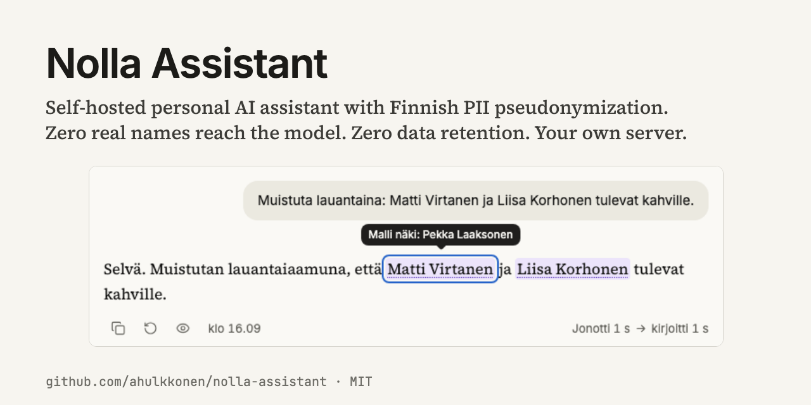
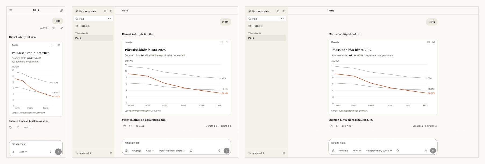
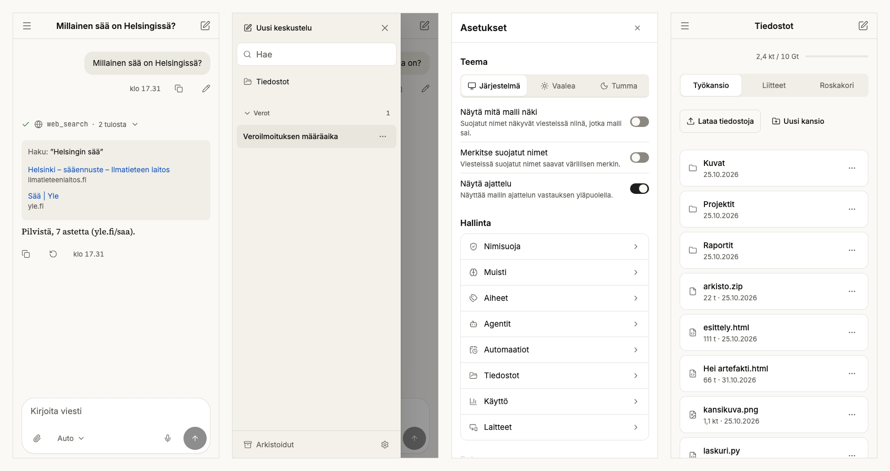
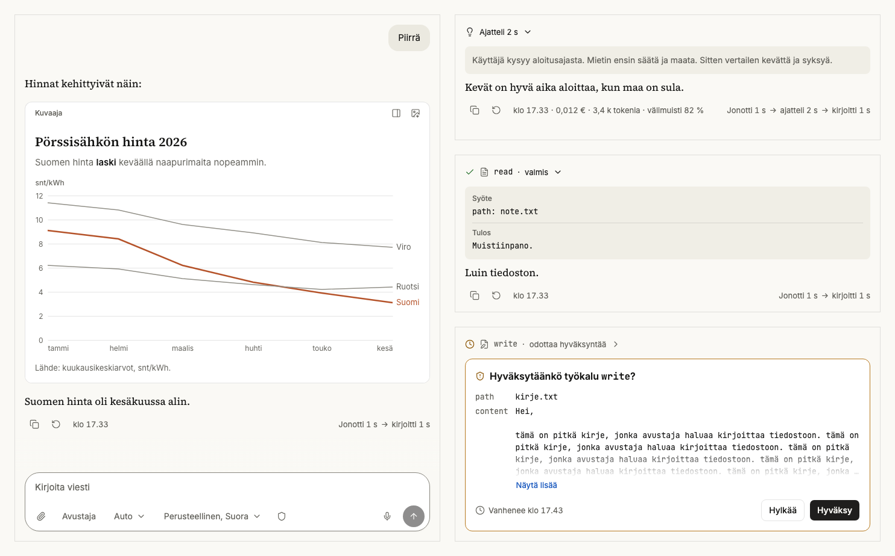
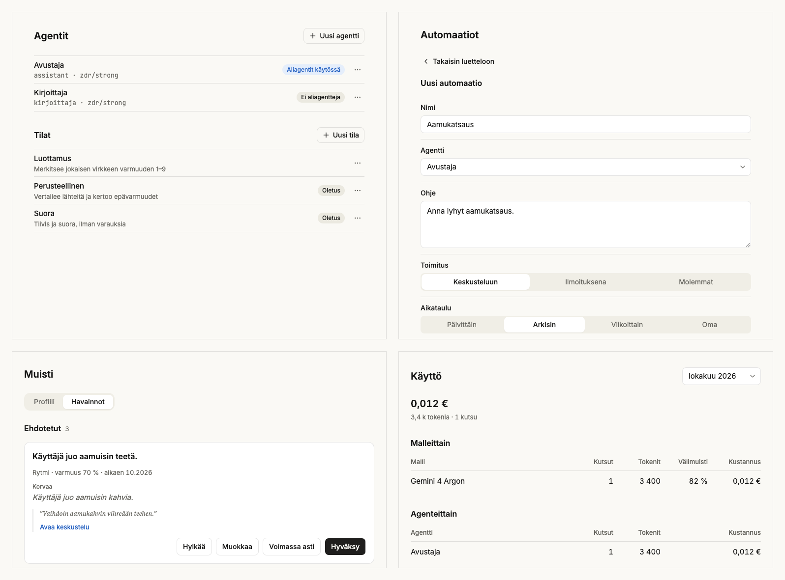
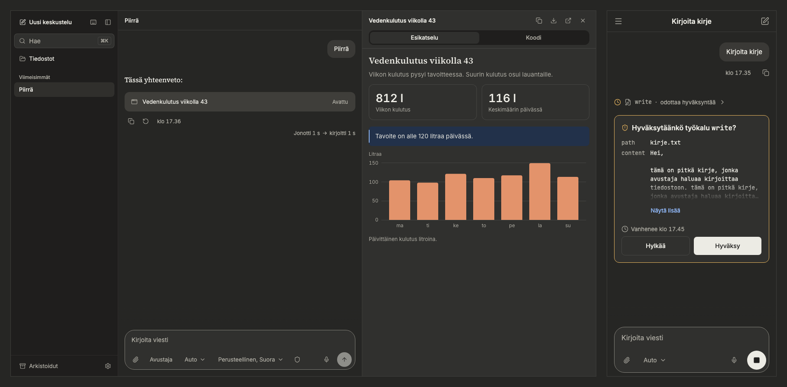
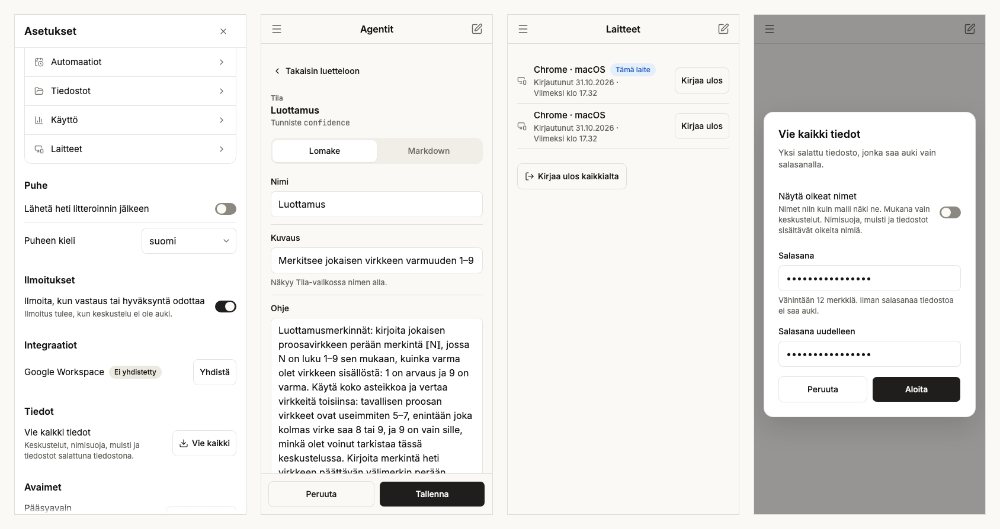
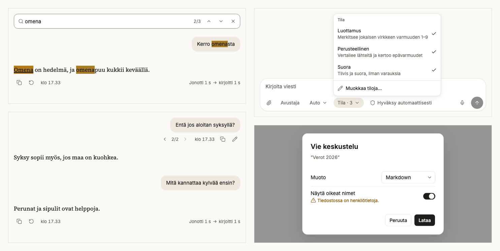
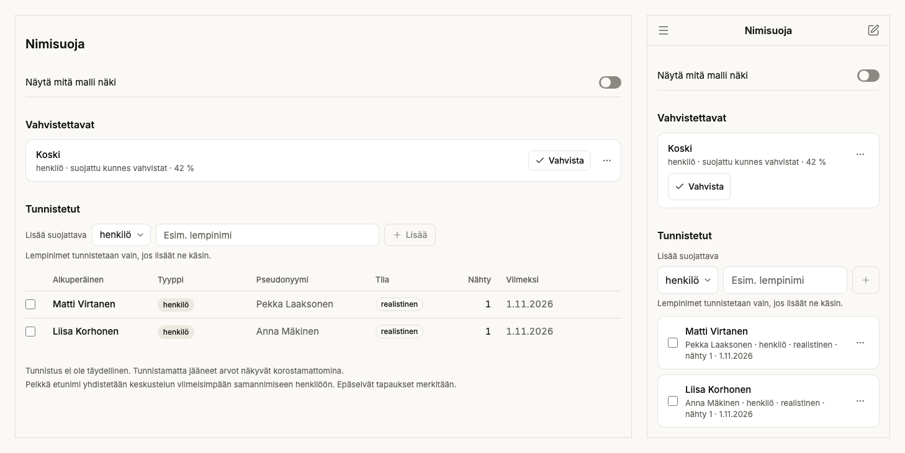
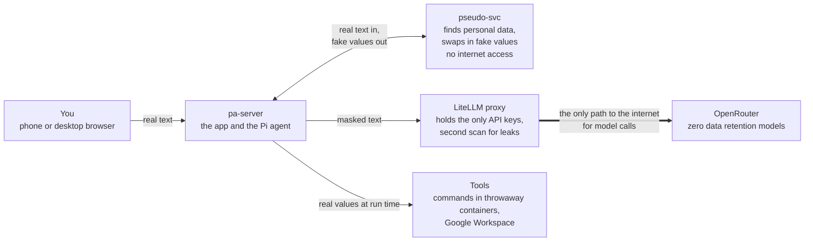

**Self-hosted personal assistant with Finnish PII masking and a smooth, native-feel mobile
experience.**

[](https://github.com/ahulkkonen/nolla-assistant/actions/workflows/ci.yml)
[](LICENSE)


Aleksi Hulkkonen with Claude Code · about 62 active hours

*Nolla* is Finnish for zero. It replaces names, ID numbers, addresses and emails with realistic fake
ones before any model sees a message. You see the real values on your screen. One proxy routes every
model call to OpenRouter endpoints with zero data retention (ZDR). The system catches 99.5 % of
names on 562 Finnish test texts.

```sh
pnpm install && pnpm --filter @nolla/web build
node tests/e2e/src/demo.ts   # no keys, no Docker: localhost:3000, password salasana
```

## Why I built it

- Open-source assistants have web UIs that feel like admin panels on a phone. I wanted the polish of
  Claude Web and ChatGPT. This app gives a smooth, native-feel mobile experience in light and dark.
  A blind reviewer scored every screen ([brief](docs/decisions/phase-9-ui.md),
  [reference](docs/decisions/0006-ui-reference.md)).
- Finnish personal data is hard to mask. Word endings change (`Virtanen`, `Virtaselle`). Common
  surnames are also ordinary words (`Koski` means rapids). The fake names get the same word endings
  ([phase 12](docs/decisions/phase-12-pseudo.md), [phase 33](docs/decisions/phase-33-recall.md)).
- You can use frontier models with ZDR on a server you own. One Docker Compose stack runs on a 4
  vCPU, 8 GB VPS. Only the proxy holds the keys
  ([0004](docs/decisions/0004-litellm-openrouter-zdr.md)).
- [Pi](https://www.npmjs.com/package/@earendil-works/pi-coding-agent) runs the agent loop. It
  supports [subagents](packages/pi-ext-subagents/src), Google Workspace through
  [MCP](docs/decisions/0005-mcp-integrations.md), and [skills](skills/README.md) in throwaway
  containers.

<p align="center"></p>
<p align="center"><sub>A reply streams in. The waiting line counts the queue, the thinking and the writing.</sub></p>

## What it does

It is built for one person on one server. You talk to it in Finnish from a phone or a desktop
browser. It answers in your language.

<table>
<tr><td></td></tr>
<tr><td><sub>One app, three widths: 390, 1024 and 1440 px. Every screen is tested at these widths, in light and dark, with strict accessibility checks (<a href="tests/e2e/src/screens.spec.ts"><code>screens.spec.ts</code></a>).</sub></td></tr>
</table>

It searches the web and draws inline charts and diagrams. It builds HTML pages that open in a
sandboxed side panel. It remembers the facts you approve, each with its evidence quote. It edits its
own prompt and automations behind an approval card. It saves each change as a git commit. It runs
scheduled tasks and keeps your files. It searches past chats with full-text and vector search inside
SQLite. Everything lives on one `/data` volume. The system makes hourly database copies and nightly
encrypted backups ([tour with proofs](docs/overview.md)).

<table>
<tr><td></td></tr>
<tr><td><sub>On a phone: a chat with its web sources, topics in the drawer, settings and files.</sub></td></tr>
<tr><td></td></tr>
<tr><td><sub>On a desktop: an inline chart, the model's thinking, a tool call with input and result, and an approval card.</sub></td></tr>
<tr><td></td></tr>
<tr><td><sub>Agents, output modes, automations, memory and usage each have a separate screen.</sub></td></tr>
<tr><td></td></tr>
<tr><td><sub>Dark mode has its own color palette: an HTML page in the side panel, and an approval card on a phone.</sub></td></tr>
</table>

<details>
<summary>More screens: settings, chat controls, approval cards, diagrams</summary>

<table>
<tr><td></td></tr>
<tr><td><sub>Settings, an output mode in its editor, your signed-in devices and the encrypted full export.</sub></td></tr>
<tr><td></td></tr>
<tr><td><sub>Find text in a chat, switch between message versions, pick output modes and export a chat.</sub></td></tr>
</table>

<table>
<tr>
<td width="50%"></td>
<td width="50%"></td>
</tr>
<tr>
<td><sub>The assistant wants to edit its own prompt. The card shows the diff and warns that the turn read content from outside the chat, such as a web page.</sub></td>
<td><sub>A Mermaid diagram in the app's own style, in dark mode.</sub></td>
</tr>
</table>

<table>
<tr><td width="55%"></td><td width="45%"></td></tr>
<tr><td colspan="2"><sub>Fetching a URL you did not write requires approval on desktop and phone.</sub></td></tr>
</table>

</details>

## How it keeps data private

- The model never sees real values. A Pi extension masks messages and tool results
  ([`pi-ext-pseudo`](packages/pi-ext-pseudo/src/index.ts)). It scans the context before each model
  call. It stops the turn if the masking service is down.
- A test runs a 10-turn conversation with tools and a restart
  ([`tests/masked-only`](tests/masked-only/src/masked-only.test.ts)). It then searches every session
  file, model request and server log for each real value.
- Tests on 562 labelled Finnish texts catch 100 % of ID numbers, IBANs, phone numbers, emails and
  addresses. They catch 99.5 % of names with 99.1 % precision ([last run](tests/pii/last-run.json)).
- Only the LiteLLM proxy holds the OpenRouter keys. A guard pins each route to a ZDR provider
  ([`zdr_guard.py`](infra/litellm/zdr_guard.py)).
- `write`, `edit`, `bash` and the self-editing tools wait for your approval, enforced in code
  ([`approval.ts`](apps/server/src/approval.ts)). `bash` runs in a throwaway container with no
  network. URL fetches refuse private addresses.
- Three audits ran before publication: security, architecture and supply chain. All blocking and
  security findings are fixed ([`docs/audits/`](docs/audits),
  [record](docs/decisions/phase-30-audits.md)).

<table>
<tr><td></td></tr>
<tr><td><sub>The reply as the model wrote it. Your screen and your calendar show the real names.</sub></td></tr>
<tr><td></td></tr>
<tr><td><sub>Add a nickname once to mask it from then on. A weak detection like <code>Koski</code> stays masked until you confirm it as a name or dismiss it (<a href="docs/decisions/phase-34-vault-add.md">phase 34</a>).</sub></td></tr>
</table>

## Architecture



## Run it

You need Node 22.19 or newer and pnpm. The demo command at the top runs without keys or Docker.

To run with real services, copy `.env.example` to `.env` and fill it in
([notes](docs/development.md#develop)). `AUTH_PASSWORD_HASH` uses `$$` in `.env` for Docker Compose
and a single `$` in the shell.

```sh
pnpm install
set -a; source .env; set +a; pnpm --filter @nolla/server dev
pnpm --filter @nolla/web dev
```

The suite has 582 Vitest, 28 Pi contract and 671 Playwright tests. Playwright runs 89 flows and 582
screen tests at three widths with strict accessibility checks. No test needs a model key.

- [`docs/overview.md`](docs/overview.md): the long version, each claim with its proof, the tour and
  the test table.
- [`docs/development.md`](docs/development.md): how to develop and test, the dependency policy, and
  the status of each phase.
- [`docs/deploy.md`](docs/deploy.md): the runbook for a VPS and for a full local run with Docker.
- [`docs/threat-model.md`](docs/threat-model.md): threats, controls and accepted risks.
- [`docs/glossary.md`](docs/glossary.md): the terms the documents use, with their plain meaning.
- [`AGENTS.md`](AGENTS.md): rules and the document index for contributors and coding agents.

## How it was built

One Claude Code session (the Fable 5.1 model) held [the plan](docs/plan.md) and ran 177 subagent
runs, up to 8 at once. An Opus architect opened each phase with a
[decision record](docs/decisions/README.md). Builders took one task each, Opus for the hard ones
and Sonnet for the mechanical ones. A reviewer read every diff, and UI changes went through a
blind, scored screenshot loop. I was the product owner on phone and desktop, and I decided the hard
design questions. The full workflow is in [`docs/workflow.md`](docs/workflow.md).

The numbers come from the session transcript ([method](docs/build-stats.md)):

| Measure | Figure |
|---|---|
| Active time (a gap over 30 min ends a block) | 61.8 h |
| Human messages | 84, at least 13.3 h present |
| Subagent runs | 177: Opus 116 (90.2 h), Sonnet 59, Haiku 2 |
| Reviewer passes | 44 diff reviews, up to five blind screenshot rounds per slice |
| Output | Over 430 commits, 42 decision records, about 62,500 lines of TypeScript and 5,300 of Python |

## Status and limits

- Single user, Finnish first. English UI, English masking and multi-user support are on the
  [roadmap](docs/roadmap.md).
- Detection is not perfect. A new nickname, a rare word ending, or a rare surname that is also an
  ordinary word can slip through ([threat model, section 5](docs/threat-model.md#5-residual-risks)).
- Images and voice audio reach the model unmasked through ZDR endpoints. A web search query reaches
  Exa unmasked when it contains no known person's name.

## License

The code is MIT, see [`LICENSE`](LICENSE). Three parts come from elsewhere. The Finnish name lists
from DVV are CC BY 4.0, with the license next to the files
([`data/dvv`](services/pseudo-svc/data/dvv)). The `pseudo-svc` image pulls Omorfi (GPL-3) and
voikko-fi (GPL-2 or later) at build time. Both stay inside that container, behind HTTP
([0003, section 3](docs/decisions/0003-finnish-pii-stack.md)).
