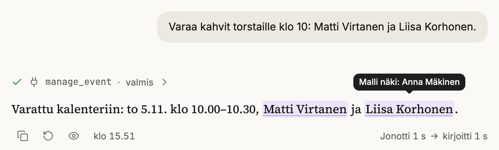
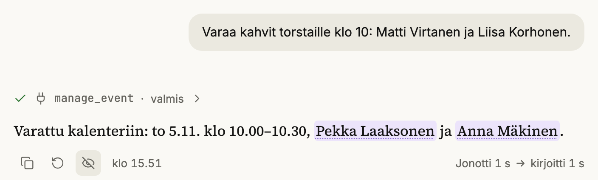
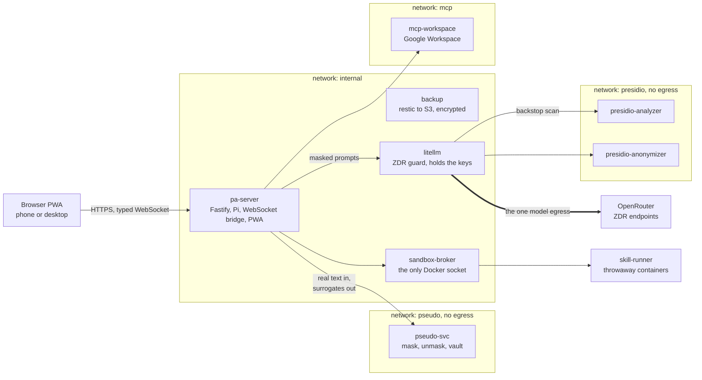

# Nolla Assistant

Aleksi Hulkkonen · built with Claude Code in seven days, 25 to 31 October 2026

*Nolla* is Finnish for zero: zero personal data reaches the model, zero data retention, zero cloud you
do not own.

A self-hosted personal assistant for one person, built on the
[Pi](https://www.npmjs.com/package/@earendil-works/pi-coding-agent) agent runtime, that you talk to
in Finnish from a phone or a desktop browser. Before any model sees a message, its names, ID
numbers, addresses and emails become realistic surrogates, and all model traffic leaves through one
proxy to OpenRouter endpoints with zero data retention (ZDR).

[](https://github.com/ahulkkonen/nolla-assistant/actions/workflows/ci.yml)



*On your screen: your message, the calendar tool that ran and the reply show the real names. A mark tells you what the model saw. The calendar got the real names too; no model request did.*



*The reply as the model wrote it: realistic surrogates in place of the names.*


## What it does

- **Runs on a phone and a desktop** as one PWA; every screen is tested at 390, 1024 and 1440 px ([`screens.spec.ts`](tests/e2e/src/screens.spec.ts)).
- **Searches the web** through OpenRouter's Exa plugin ([`search-tool.ts`](apps/server/src/search-tool.ts)).
- **Draws charts and diagrams** inline: Vega-Lite with the app's theme, Mermaid in the "Sarake" look ([`viz.ts`](apps/web/src/viz.ts), [`render.ts`](apps/web/src/render.ts)).
- **Builds HTML pages** that run in a sandboxed frame in the side panel ([`Sandbox.tsx`](apps/web/src/components/Sandbox.tsx)).
- **Remembers what you approve:** claims with evidence quotes, and each proposed claim waits for review ([`claims.ts`](apps/server/src/claims.ts)).
- **Edits its own prompt and automations** with harness tools, each behind a diff or YAML card and saved as a git commit ([`harness.ts`](apps/server/src/harness.ts)).
- **Runs scheduled tasks** from cron automations in YAML ([`automations/`](automations/README.md)).
- **Works with your files** in a Files screen with trash and a quota ([phase 11](docs/decisions/phase-11-files.md)).
- **Searches past chats** inside SQLite: FTS5, sqlite-vec and rank fusion over local embeddings ([`search.ts`](apps/server/src/search.ts)).
- **Keeps SQLite, JSONL sessions and Markdown memory on one `/data` volume**, with hourly consistent database backups through restic ([`restore.sh`](scripts/restore.sh)).

## How it keeps data private

- **Masked-only sessions:** [`pi-ext-pseudo`](packages/pi-ext-pseudo/src/index.ts) masks messages and tool results, scans the context before each model call, and stops the turn if [`pseudo-svc`](services/pseudo-svc) is down.
- **Checked end to end:** [`tests/masked-only`](tests/masked-only/src/masked-only.test.ts) runs a 10-turn tool conversation and a restart, then searches sessions, model requests and the server log for each real value.
- **Finnish detection, measured** on 554 labelled texts: ID numbers, IBANs and phones at 100 % recall, names at 0.986 recall and 0.991 precision ([last run](tests/pii/last-run.json)).
- **One egress URL:** only LiteLLM holds the OpenRouter keys, and [`zdr_guard.py`](infra/litellm/zdr_guard.py) pins each route to its provider block.
- **Approval cards that code enforces:** `write`, `edit`, `bash` and the harness tools wait in a Pi hook for your answer ([`approval.ts`](apps/server/src/approval.ts)).
- **Sandboxed commands, guarded fetches:** `bash` runs in throwaway containers with no network by default ([`index.ts`](services/sandbox-broker/src/index.ts)), and `fetch_url` refuses private addresses ([`net.ts`](services/sandbox-broker/src/net.ts)).


*`profile_edit` waits for a card with the diff. The turn read outside content, so the card warns.*


*A Mermaid diagram in the "Sarake" look, in dark mode.*

<table>
<tr><td width="55%"></td><td width="45%"></td></tr>
<tr><td colspan="2">A <code>fetch_url</code> call to an address that you did not write waits for a card, at 1440 px and on a 390 px phone.</td></tr>
</table>

## Architecture



## Run it

```sh
pnpm install && pnpm --filter @pa/web build
node tests/e2e/src/demo.ts   # no keys, no Docker: localhost:3000, password salasana
```

With real services: copy `.env.example` to `.env` and fill it in ([notes](docs/development.md#develop)):

```sh
pnpm install
set -a; source .env; set +a; pnpm --filter @pa/server dev
pnpm --filter @pa/web dev
```

- [`docs/overview.md`](docs/overview.md): the long form, with each claim and its proof, the tour and the test table.
- [`docs/development.md`](docs/development.md): prerequisites, test commands, dependency policy, the status of each phase.
- [`docs/deploy.md`](docs/deploy.md): the runbook for the VPS and for a full local run with Docker.
- [`docs/threat-model.md`](docs/threat-model.md): threats, mitigations and accepted risks.
- [`AGENTS.md`](AGENTS.md): rules and the document index for contributors and coding agents.

## Built in seven days with Claude Code

- **Process:** a plan first ([`docs/plan.md`](docs/plan.md)), Claude Code orchestrating Opus and Sonnet implementers, a separate review before every merge, a blind scored screenshot review for each UI change; 29 phases done, with 39 [decision records](docs/decisions/README.md).
- **Audits before publication:** [security](docs/audits/2026-10-31-security.md) 2 blocking and 6 should-fix, [architecture](docs/audits/2026-10-31-architecture.md) 1 blocking and 14 should-fix, [supply chain](docs/audits/2026-10-31-dependencies.md) no malicious package in 1,260 npm lock entries and 64 Python packages; phase 30 fixed the blocking and the security findings ([record](docs/decisions/phase-30-audits.md)).
- **Tests:** 572 Vitest, 28 Pi contract and 658 passing Playwright tests (flows, and every screen at three widths with strict axe checks); no CI test needs a model key ([`tests/fake-llm`](tests/fake-llm/src/index.ts)).

## Status and limits

- Single user, Finnish first. Deferred: a direct search backend, text-to-speech and multi-user.
- Detection is not perfect: nicknames outside the table and rare inflections can slip through.
- Images and voice audio reach the model unmasked, through ZDR endpoints; a web search query reaches Exa unmasked when it names no vault entity.

MIT license, see [`LICENSE`](LICENSE).
