# Avustaja

**A self-hosted personal assistant with Finnish PII pseudonymization and zero-data-retention model egress.**

<!-- CI badge: replace OWNER/REPO with the GitHub owner and repository name. -->
[](https://github.com/OWNER/REPO/actions/workflows/ci.yml)
[](LICENSE)

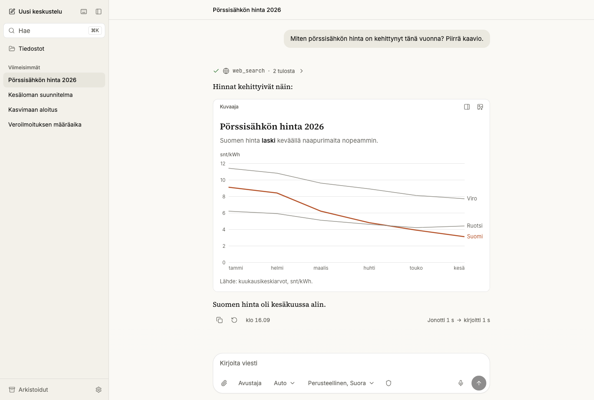

A personal assistant for one person, on one small server. You talk to it in Finnish from a phone or
a desktop browser; it searches the web, works with your files, draws charts and diagrams, remembers
what you approve, and runs scheduled tasks. Before any model sees a message, the names, ID numbers,
addresses and emails in it become realistic surrogates, and all model traffic leaves through one
proxy to OpenRouter endpoints with zero data retention. It exists because nothing off the shelf
combined frontier models, Finnish pseudonymization and data that stays on a box you own.

## What makes it different

**Real values never reach a model.** `packages/pi-ext-pseudo` masks each message at Pi's `input`
hook, unmasks tool arguments only when the tool runs, masks every tool result, and scans the whole
context before each model call. If the pseudonymization service is down, the turn stops; it never
falls back to clear text. Titles, topics, memory extraction and subagents read the same masked text.
`tests/masked-only` runs a 10-turn tool conversation and a restart, then searches every session file,
every model request and the server log for each real value.

<table>
<tr>
<td width="50%">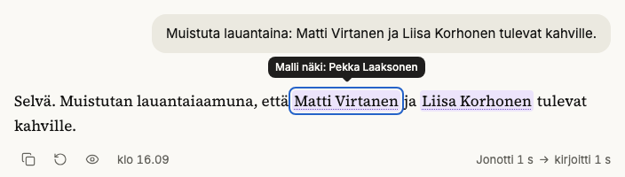</td>
<td width="50%">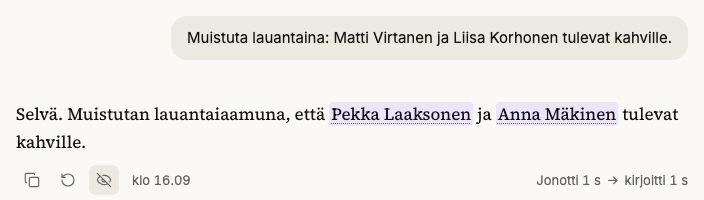</td>
</tr>
<tr>
<td>On your screen: real names. A mark tells what the model saw.</td>
<td>What the model saw: surrogates. One switch shows this view.</td>
</tr>
</table>

The vault in `services/pseudo-svc` (FastAPI, Presidio, spaCy, Voikko, Omorfi, SQLCipher) gives each
person a surrogate that inflects like a Finnish name, so `Virtaselle` can go out as `Laaksoselle` and
the model writes natural Finnish. The stream is restored on the server with a short hold-back, so a
surrogate split across two chunks never shows half-restored (`apps/server/src/restore.ts`).

**One egress URL, zero data retention.** Pi knows two providers, and both point at LiteLLM. Only
LiteLLM holds the OpenRouter keys. `infra/litellm/zdr_guard.py` allows only listed models and refuses
unknown request keys, `extra_body` and plugins. Every `zdr/` request carries `provider.zdr`, on a
key that sits under an OpenRouter ZDR guardrail. `tests/egress` runs LiteLLM and Presidio against a
mock OpenRouter. A chat can leave ZDR after a refusal; it then uses a separate key and stays
pseudonymized.

**Approval cards that code enforces.** `write`, `edit`, `bash` and the harness tools stop in a Pi
`tool_call` hook until you answer a card built from the call's real arguments
(`apps/server/src/approval.ts`). The harness tools always ask, even when auto-approve is on for the
chat. A scheduled run has no one to ask, so it denies every gated tool that its automation does not
list. A message whose tool calls repeat or lack an id is refused. A card in a turn that read
outside content says so.

**Harness tools: the assistant edits its own setup, with a diff.** `profile_edit` changes the
assistant's prompt, `automation_edit` writes a cron automation, and `chat_read` reads another chat.
Each one shows a diff or a YAML card first (`apps/server/src/harness.ts`), and each saved change is a
git commit on the data volume. `profile_edit` cannot change tools, approvals or the model.
`fetch_url` sends one GET with no body, cookie or key, to ports 80 and 443 only, through a DNS-pinned
lookup that refuses private addresses (`services/sandbox-broker/src/net.ts`). Each redirect is
checked again, and a URL that you did not write waits for a card (`apps/server/src/fetch-tool.ts`).

**Sandboxed skills.** Only `sandbox-broker` holds the Docker socket. Each command runs in a new
container as uid 10001, with a read-only root, `CapDrop: ALL`, `no-new-privileges`, pid, memory and
CPU limits, a seccomp profile that denies symlinks, and no network by default
(`services/sandbox-broker/src/index.ts`). A skill can ask for a list of hosts, which it reaches only
through the broker's proxy, or for the open internet. Skills come only from this repository; nothing
installs at run time. No skill is vendored yet; the agent's `bash` tool already runs this way.
`tests/sandbox` drives the broker against real containers.

**Local-first data with consistent backups.** SQLite in WAL mode, Pi's JSONL sessions and Markdown
memory live under one `/data` volume. Search is hybrid and stays in SQLite: FTS5 trigram, sqlite-vec
and reciprocal rank fusion over local multilingual-e5 embeddings (`apps/server/src/search.ts`).
Every hour the backup service takes consistent copies of `app.db` and of the SQLCipher vault, and
every night restic snapshots all of `/data`. `scripts/restore.sh` refuses a database that fails
`PRAGMA integrity_check`, and `scripts/restore-drill.sh` exercises the restore.

## Architecture

Eight services on one Docker Compose stack, built for one Coolify host (a 4 vCPU, 8 GB VPS). Only
`pa-server` is exposed. It runs Pi in-process through the SDK, one session per open chat, and talks
to the browser in a zod-typed WebSocket protocol (`packages/protocol`). Raw Pi events never reach
the browser.

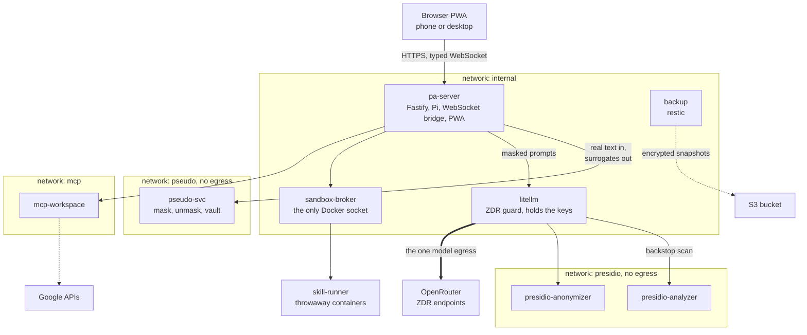

One turn, end to end:

1. The PWA sends `user.message` over the WebSocket.
2. `pi-ext-pseudo` masks it at Pi's `input` hook, and the vault records the surrogates.
3. Pi calls the model through LiteLLM with masked history and masked memory.
4. A tool call is unmasked only when it runs; its result is masked before Pi reads it.
5. The bridge restores the stream for display and sends typed frames to the browser.

Other outbound calls carry no model traffic: `fetch_url` GETs, the public model catalog, the ECB
exchange rate, Web Push, Google APIs from `mcp-workspace`, and the encrypted backups.

```
apps/web                 React 19 PWA: Vite, Tailwind 4, shadcn/ui, zustand
apps/server              Fastify host: Pi sessions, WebSocket bridge, approvals, harness tools, search
packages/protocol        zod schemas for every client-server message
packages/db              drizzle SQLite schema and migrations
packages/pi-ext-*        Pi extensions: pseudo, memory, topics, subagents, sandbox
services/pseudo-svc      Python FastAPI: mask, unmask, scan, the vault
services/sandbox-broker  runs skill commands in throwaway containers
agents/ automations/     the agent profile, output modes, cron automations (YAML, Markdown)
infra/                   Compose files, Dockerfiles, LiteLLM config, backup
tests/                   contract, e2e, egress, fake-llm, masked-only, mcp, memory-eval, pii, sandbox
docs/                    plan, deploy runbook, decision records, audits
```

## A tour

The interface follows a written design brief (`docs/decisions/phase-9-ui.md`, section 7): a cream
canvas, serif replies in one centered column, ink for the one primary action, and controls that
stay quiet until you need them. The UI is in Finnish. The names and data in these shots are synthetic.

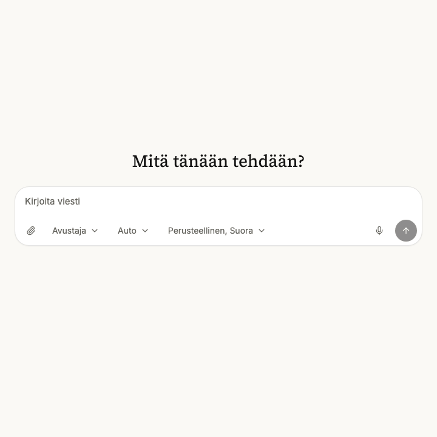

A reply streams in. The waiting line counts the queue, the thinking and the writing, and the caret
stays on the last character.

<table>
<tr>
<td width="50%">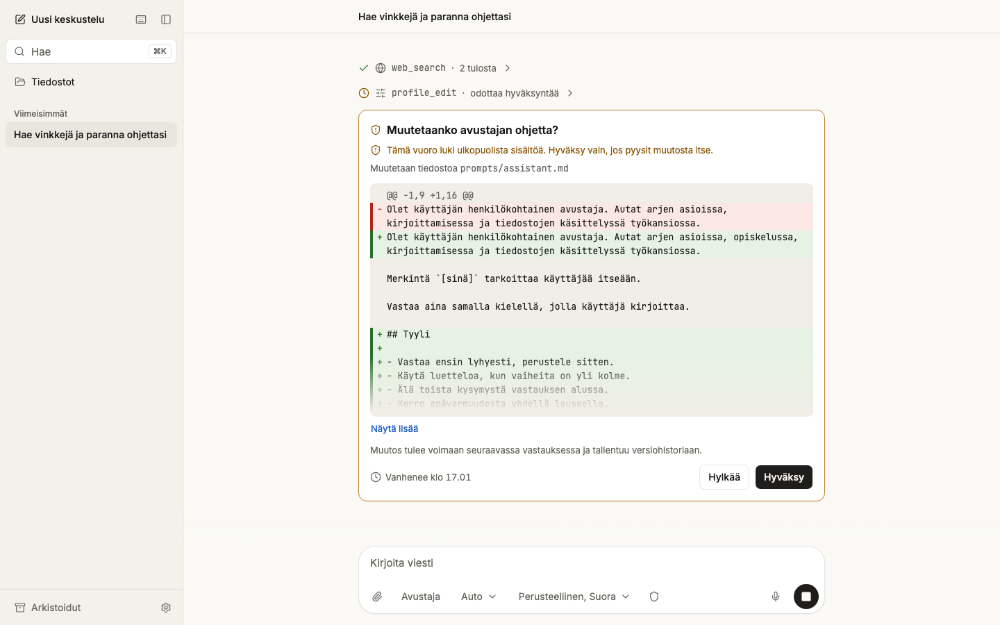</td>
<td width="50%">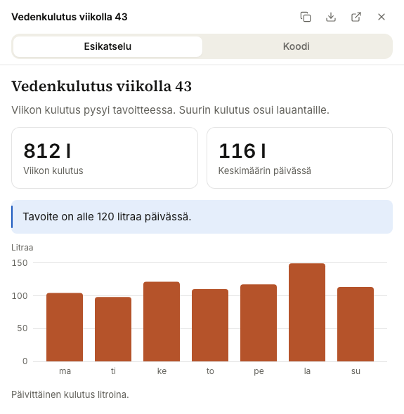</td>
</tr>
<tr>
<td><code>profile_edit</code> waits for a card with the diff. The turn read outside content, so the card warns.</td>
<td>Charts are Vega-Lite specs with an injected theme. They render inline and open in the panel.</td>
</tr>
<tr>
<td>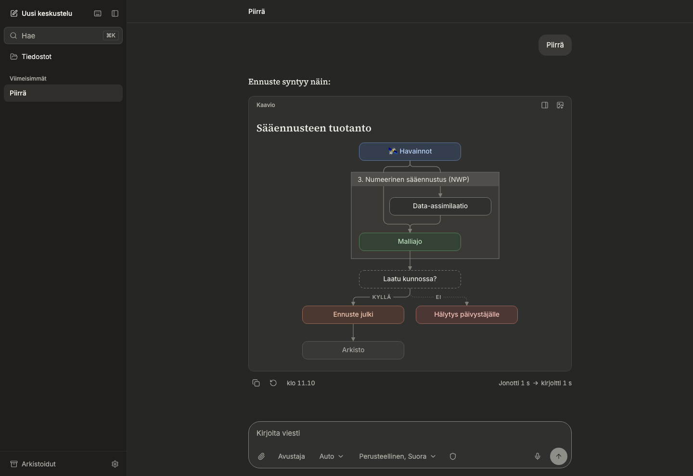</td>
<td>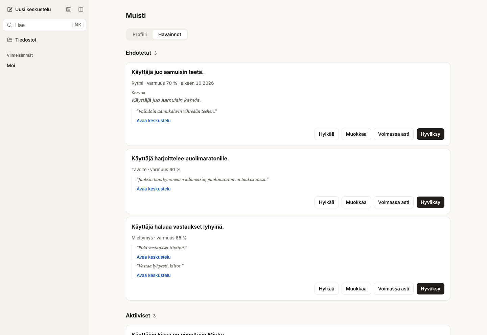</td>
</tr>
<tr>
<td>Mermaid diagrams get the "Sarake" look. Dark mode has its own palette.</td>
<td>Memory is a list of claims with evidence quotes. A proposed claim waits for your review.</td>
</tr>
<tr>
<td>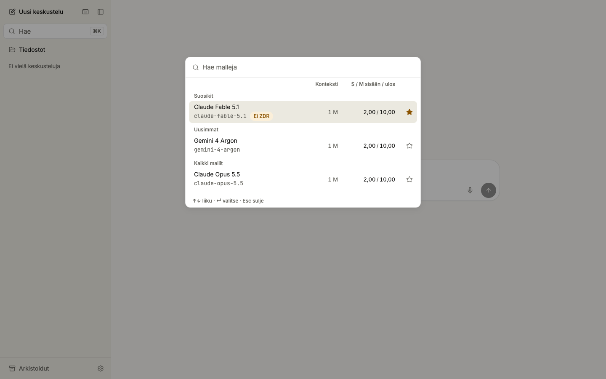</td>
<td>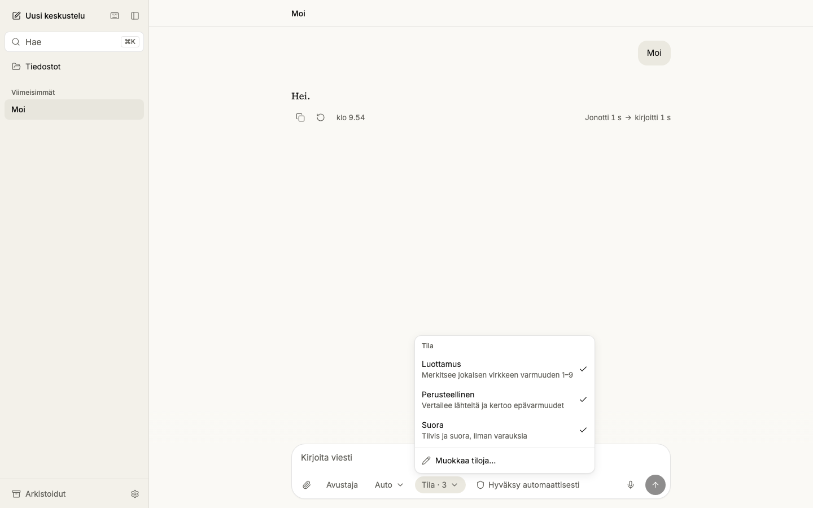</td>
</tr>
<tr>
<td>The model catalog comes from OpenRouter's public list. "Uusimmat" holds each lab's newest model; "Ei ZDR" marks a model without a ZDR endpoint.</td>
<td>Output modes sit under the "Tila" chip. Each mode is a Markdown file in <code>agents/modes/</code>.</td>
</tr>
<tr>
<td>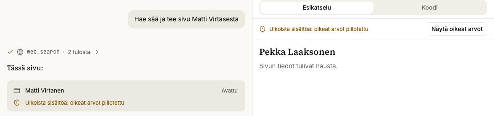</td>
<td>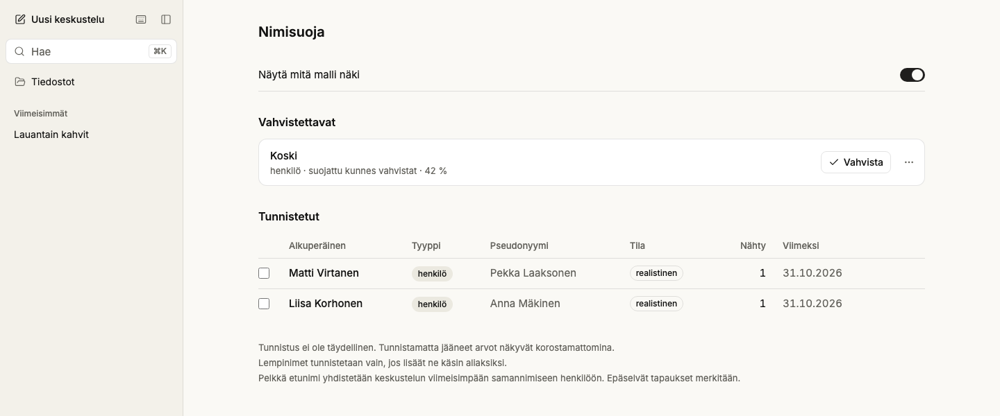</td>
</tr>
<tr>
<td>A page from a chat that read outside content runs on surrogates. "Näytä oikeat arvot" asks before it shows real values.</td>
<td>The vault lists each real value and its surrogate. A weak detection stays masked until you confirm it.</td>
</tr>
</table>

<table>
<tr>
<td width="76%">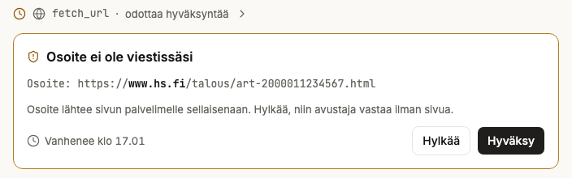</td>
<td width="24%">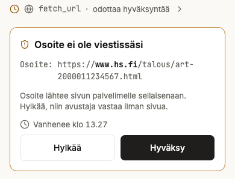</td>
</tr>
<tr>
<td colspan="2">A <code>fetch_url</code> call to an address that you did not write waits for a card: at 1440 px, and on a 390 px phone.</td>
</tr>
</table>

## How it was built

One person and Claude Code built it in seven days, from 25 to 31 October 2026, in more than 370
commits.

- **A plan before code.** `docs/plan.md` fixed the invariants, the architecture, the protocol, the
  PII and memory designs, the UI spec, and the phases with their gates before the first commit.
- **Claude Code as the orchestrator.** It held the plan, cut each phase into task cards, gave the
  architecture-bearing tasks to Opus and the well-specified leaf tasks to Sonnet, and merged.
- **Review before every commit.** A separate reviewer checked each change against its acceptance
  test, the invariants and security before the commit, so `git log` is the review log. The commits
  keep their `Co-Authored-By: Claude` trailers.
- **A blind, scored screenshot review.** Each UI change was shot at 390, 1024 and 1440 px, in light
  and dark. A reviewer who had not seen the diff scored every shot from 1 to 5 on six criteria
  against the design brief. Blocking and should-fix findings were fixed before the merge.
- **31 phases and 39 decision records** under `docs/decisions/`: one record per phase (phase 18, a
  search backend, was deferred; phase 29, evals, has no record yet), plus ten records for
  cross-cutting decisions such as the Pi contract and the Finnish PII stack. Each newer record lists
  the review findings that were left as they are, on purpose.
- **Three audits before publication**, in `docs/audits/`: security (2 blocking, 6 should-fix,
  14 nice-to-have), architecture (1 blocking, 14 should-fix, 29 nice-to-have) and supply chain
  (1,260 npm lock entries and 64 Python packages against advisory, malware and IOC lists: no
  malicious package, nothing to remove). Phase 30 fixed the blocking and the security findings and
  most architecture findings; `docs/decisions/phase-30-audits.md` lists each fix and what stays.

No test needs a model key. `tests/fake-llm` is an in-process OpenAI-compatible server with scripted
turns, and fakes stand in for the pseudonymization sidecar and the sandbox broker.

| Suite | What it checks | Size or result |
|---|---|---|
| Vitest | protocol, db, web, Pi extensions, MCP, and the real server driven over its socket | 572 tests |
| `tests/contract` | the hook payloads and session behaviour of the pinned Pi version | 28 tests |
| `tests/masked-only` | no real value in sessions, model requests or the server log | a 10-turn tool conversation and a restart |
| Playwright `chromium` | user flows, and every screen at 390, 1024 and 1440 px, light and dark, with strict axe checks | 86 flows and 582 screen tests: 658 pass, 10 skip by design |
| `tests/pii` | recall and precision gates on 554 labelled Finnish texts | ID numbers, IBANs, phones: 100 % recall; names: 0.986 recall, 0.991 precision |
| `tests/memory-eval` | 100 questions over 30 synthetic Finnish chats, on the real sidecar | gold evidence reaches the model: 0.988; answer accuracy 0.72 to 0.82 over six runs |
| `tests/egress`, `tests/sandbox` | LiteLLM and Presidio against a mock OpenRouter; the broker with real containers (Docker) | 23 and 19 tests |

CI (`.github/workflows/ci.yml`) runs typecheck, lint, the unit suites, the contract tests,
`tests/masked-only` and the Playwright run on every push to `main` and on every pull request. The
Docker suites, the PII harness and the restore drill run locally.

## Run it

Try the interface with no keys and no Docker. A fake model echoes the masked text that it got:

```sh
pnpm install && pnpm --filter @pa/web build
node tests/e2e/src/demo.ts        # http://localhost:3000, password: salasana
```

Develop against real services: copy `.env.example` to `.env`, fill in the values, then run

```sh
pnpm install
set -a; source .env; set +a; pnpm --filter @pa/server dev
pnpm --filter @pa/web dev
```

`docs/deploy.md` is the runbook for the VPS and for a full local run with Docker.
`docs/development.md` has the prerequisites, the test commands, the dependency policy and the
status of each phase. Contributors and coding agents start with `AGENTS.md`.

## Status and limits

It runs for one user, in Finnish first. Every row has a `user_id`, so more users are a schema
no-op, but nothing else is built for them. Deferred: a direct search backend (web search goes
through OpenRouter's Exa plugin today), text-to-speech, and multi-user.

Known limits, from the records: detection is not perfect, and nicknames outside the table or rare
inflections can slip through; the vault screen says so. Images and voice audio reach the model
unmasked, through ZDR endpoints. A web search query reaches Exa unmasked when it names no vault
entity. The threat-model note that the plan asks for is not written yet.

MIT license, see [`LICENSE`](LICENSE).
