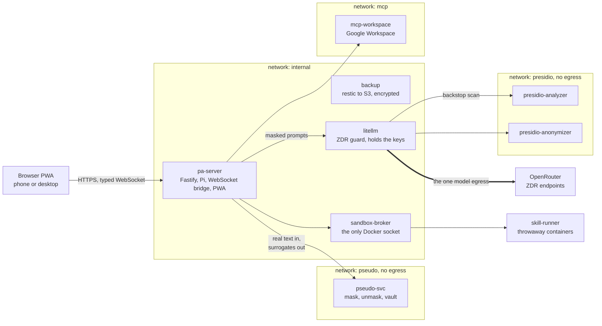

# Nolla Assistant

Aleksi Hulkkonen · built with Claude Code in about 62 active hours

*Nolla* is Finnish for zero: zero personal data reaches the model, zero data retention, zero cloud you
do not own. Measured, not promised: 99.5 % of names on 562 Finnish test texts. A doubtful one is
masked and queued for you, and a name you add once stays known.

A self-hosted personal assistant for one person, built on the
[Pi](https://www.npmjs.com/package/@earendil-works/pi-coding-agent) agent runtime, that you talk to
in Finnish from a phone or a desktop browser. Before any model sees a message, its names, ID
numbers, addresses and emails become realistic surrogates, and all model traffic leaves through one
proxy to OpenRouter endpoints with zero data retention (ZDR).

[](https://github.com/ahulkkonen/nolla-assistant/actions/workflows/ci.yml)


*On your screen: your message, the calendar tool that ran and the reply show the real names. A mark tells you what the model saw. The calendar got the real names too. No model request did.*


*The reply as the model wrote it: realistic surrogates in place of the names.*

## Why

I built it for four things that I did not find together in one open-source assistant:

- **A modern web UI with a smooth phone experience.** The reference is Claude Web for the thread,
  colours and type, and ChatGPT for the composer and inline blocks
  ([UI research](docs/decisions/0006-ui-reference.md)). The open-source assistants that I tried were
  not at that level, mainly on a phone. A reviewer that never sees the code scores every screen 1 to
  5 on six criteria against that bar ([brief and protocol](docs/decisions/phase-9-ui.md)).
- **Finnish PII pseudonymization.** This is hard. Finnish names inflect (`Virtanen` becomes
  `Virtaselle` in "to Virtanen"), and many common surnames are ordinary words (`Koski` is "rapids",
  `Salmi` is "strait"). Each surrogate inflects like the real name
  ([phase 12](docs/decisions/phase-12-pseudo.md), [phase 33](docs/decisions/phase-33-recall.md)).
- **A self-hosted, zero-data-retention path to frontier models.** It runs as one Docker Compose
  stack on a 4 vCPU, 8 GB VPS ([`compose.yaml`](infra/compose.yaml)). Only the LiteLLM proxy holds
  the keys, and it sends only to OpenRouter ZDR endpoints ([0004](docs/decisions/0004-litellm-openrouter-zdr.md)).
- **The Pi agent harness.** Pi runs the agent loop, with subagents
  ([`pi-ext-subagents`](packages/pi-ext-subagents/src)), MCP tools for Google Workspace
  ([0005](docs/decisions/0005-mcp-integrations.md)) and skills that run in throwaway containers
  ([`skills/`](skills/README.md), none vendored yet).

<p align="center"></p>
<p align="center"><sub>A reply streams in. The waiting line counts the queue, the thinking and the writing, and the caret stays on the last character.</sub></p>

## What it does

<table>
<tr><td></td></tr>
<tr><td><sub>One app, three widths: the same chat at 390, 1024 and 1440 px. Every screen is tested at these widths, in light and dark, with strict axe checks (<a href="tests/e2e/src/screens.spec.ts"><code>screens.spec.ts</code></a>).</sub></td></tr>
</table>

- **Searches the web** through OpenRouter's Exa plugin ([`search-tool.ts`](apps/server/src/search-tool.ts)).
- **Draws charts and diagrams** inline: Vega-Lite with the app's theme, Mermaid in the "Sarake" look ([`viz.ts`](apps/web/src/viz.ts), [`render.ts`](apps/web/src/render.ts)).
- **Builds HTML pages** that run in a sandboxed frame in the side panel ([`Sandbox.tsx`](apps/web/src/components/Sandbox.tsx)).
- **Remembers what you approve:** claims with evidence quotes, and each proposed claim waits for review ([`claims.ts`](apps/server/src/claims.ts)).
- **Edits its own prompt and automations** with harness tools, each behind a diff or YAML card and saved as a git commit ([`harness.ts`](apps/server/src/harness.ts)).
- **Runs scheduled tasks** from cron automations in YAML ([`automations/`](automations/README.md)).
- **Works with your files** in a Files screen with trash and a quota ([phase 11](docs/decisions/phase-11-files.md)).
- **Searches past chats** inside SQLite: FTS5, sqlite-vec and rank fusion over local embeddings ([`search.ts`](apps/server/src/search.ts)).
- **Keeps SQLite, JSONL sessions and Markdown memory on one `/data` volume**, with hourly consistent database copies and nightly restic snapshots ([`restore.sh`](scripts/restore.sh)).

<table>
<tr><td></td></tr>
<tr><td><sub>On a 390 px phone: a chat with its web sources, topics in the drawer, settings and files. The phone shots run under touch emulation.</sub></td></tr>
<tr><td></td></tr>
<tr><td><sub>Settings, an output mode in its editor, your signed-in devices and the encrypted full export (<a href="docs/decisions/phase-15-admin.md">phase 15</a>).</sub></td></tr>
</table>

<table>
<tr><td></td></tr>
<tr><td><sub>A chart inline in the reply, the model's thinking, a tool call with its input and result, and an approval card (<a href="docs/decisions/phase-13-thread.md">phase 13</a>, <a href="docs/decisions/phase-20-thread.md">phase 20</a>).</sub></td></tr>
<tr><td></td></tr>
<tr><td><sub>Find text in a chat, switch between message versions, pick output modes and export a chat (<a href="docs/decisions/phase-24-edit-in-place.md">phase 24</a>, <a href="docs/decisions/phase-23-modes-router.md">phase 23</a>).</sub></td></tr>
</table>

<table>
<tr><td></td></tr>
<tr><td><sub>Agents, output modes, automations, memory and usage each have a screen of their own (<a href="docs/decisions/phase-15-admin.md">phase 15</a>, <a href="docs/decisions/phase-17-memory.md">phase 17</a>).</sub></td></tr>
<tr><td></td></tr>
<tr><td><sub>Dark mode has its own palette: an HTML artifact in the side panel at 1440 px, and an approval card on a phone.</sub></td></tr>
</table>

## How it keeps data private

- **Masked-only sessions:** [`pi-ext-pseudo`](packages/pi-ext-pseudo/src/index.ts) masks messages and tool results, scans the context before each model call, and stops the turn if [`pseudo-svc`](services/pseudo-svc) is down.
- **Checked end to end:** [`tests/masked-only`](tests/masked-only/src/masked-only.test.ts) runs a 10-turn tool conversation and a restart, then searches sessions, model requests and the server log for each real value.
- **Finnish detection, measured** on 562 labelled texts: ID numbers, IBANs, phones, emails and addresses at 100 % recall, names at 0.995 recall and 0.991 precision (vault-known names 100 %, first sight 0.993) ([last run](tests/pii/last-run.json)).
- **One egress URL:** only LiteLLM holds the OpenRouter keys, and [`zdr_guard.py`](infra/litellm/zdr_guard.py) pins each route to its provider block.
- **Approval cards that code enforces:** `write`, `edit`, `bash` and the harness tools wait in a Pi hook for your answer ([`approval.ts`](apps/server/src/approval.ts)).
- **Sandboxed commands, guarded fetches:** `bash` runs in throwaway containers with no network by default ([`index.ts`](services/sandbox-broker/src/index.ts)), and `fetch_url` refuses private addresses ([`net.ts`](services/sandbox-broker/src/net.ts)).
- **Audited before publication** ([`docs/audits/`](docs/audits)): the security audit found 2 blocking and 6 should-fix findings, the architecture audit 1 blocking and 14 should-fix. The supply-chain audit found no malicious package in 1,260 npm lock entries and 64 Python packages. Phase 30 fixed the blocking and the security findings ([record](docs/decisions/phase-30-audits.md)).

<table>
<tr><td></td></tr>
<tr><td><sub>Add a nickname or another value on the vault screen once, and it is masked from then on. A weak detection such as <code>Koski</code> stays masked until you confirm it (<a href="docs/decisions/phase-34-vault-add.md">phase 34</a>).</sub></td></tr>
</table>

<table>
<tr>
<td width="50%"></td>
<td width="50%"></td>
</tr>
<tr>
<td><sub><code>profile_edit</code> waits for a card with the diff. The turn read outside content, so the card warns.</sub></td>
<td><sub>A Mermaid diagram in the "Sarake" look, in dark mode.</sub></td>
</tr>
</table>

<table>
<tr><td width="55%"></td><td width="45%"></td></tr>
<tr><td colspan="2"><sub>A <code>fetch_url</code> call to an address that you did not write waits for a card, at 1440 px and on a 390 px phone.</sub></td></tr>
</table>

## Architecture



## Run it

```sh
pnpm install && pnpm --filter @pa/web build
node tests/e2e/src/demo.ts   # no keys, no Docker: localhost:3000, password salasana
```

With real services: copy `.env.example` to `.env` and fill it in ([notes](docs/development.md#develop)):

```sh
pnpm install
set -a; source .env; set +a; pnpm --filter @pa/server dev
pnpm --filter @pa/web dev
```

Tests: 582 Vitest, 28 Pi contract and 671 Playwright tests (89 flows, and 582 screen tests at three
widths with strict axe checks). No test needs a model key ([`tests/fake-llm`](tests/fake-llm/src/index.ts)).

- [`docs/overview.md`](docs/overview.md): the long form, with each claim and its proof, the tour and the test table.
- [`docs/development.md`](docs/development.md): prerequisites, test commands, dependency policy, the status of each phase.
- [`docs/deploy.md`](docs/deploy.md): the runbook for the VPS and for a full local run with Docker.
- [`docs/threat-model.md`](docs/threat-model.md): threats, mitigations and accepted risks.
- [`AGENTS.md`](AGENTS.md): rules and the document index for contributors and coding agents.

## How it was built

One Claude Code session conducted 177 subagent runs. The figures come from its transcript
([method and full workflow](docs/workflow.md)):

| Measure | Figure |
|---|---|
| Active time (a gap over 30 min ends a block) | 61.8 h. With a 15 or 60 min gap: 43.9 h or 72.3 h |
| Claude Code session counter | 76.2 h session time, 37.3 h API time |
| Human messages and presence | 84 messages (9 with a screenshot), at least 13.3 h present |
| Active time with no new instruction for 10 min | 79 % |
| Subagent runs | 177: Opus 5.5 116 (90.2 h), Sonnet 5.5 59 (2.9 h), Haiku 5.5 2. Up to 8 at once |
| Reviewer passes | 44 diff reviews (43 on Sonnet), 5 to 6 blind screenshot rounds on each large UI phase |
| Output | Over 430 commits, 43 decision records, about 62,500 lines of TypeScript and 5,300 of Python |

The conductor (Fable 5.1) held [the plan](docs/plan.md) and never called Edit. An Opus architect
opened each phase with a [decision record](docs/decisions/README.md) and task cards. Builders took
one card or package each, Opus for hard cards and Sonnet for mechanical ones, up to eight at once. A
reviewer read every diff, and a fix agent closed every blocking and should-fix finding. UI changes
went through the blind scored screenshot loop, and the gates ran before each commit. I was the
product owner on phone and desktop, decided the hard design questions, and ran two Claude Web deep
research passes for planning and benchmarks ([0006](docs/decisions/0006-ui-reference.md),
[0007](docs/decisions/0007-memory-and-search-research.md), [0008](docs/decisions/0008-viz-research.md)).

## Status and limits

- Single user, Finnish first. Deferred: a direct search backend, text-to-speech and multi-user.
- Detection is not perfect: a nickname before you add it, a rare inflection or a rare surname that is also an ordinary word can slip through ([threat model, section 5](docs/threat-model.md#5-residual-risks)).
- Images and voice audio reach the model unmasked, through ZDR endpoints. A web search query reaches Exa unmasked when it names no vault entity.
- What comes next, with costs: [`docs/roadmap.md`](docs/roadmap.md).

MIT license, see [`LICENSE`](LICENSE).
