# Nolla Assistant: overview

This is the long form of the README. [`README.md`](../README.md) is the short form.

**A self-hosted personal assistant with Finnish PII pseudonymization and zero-data-retention model
egress.**

Aleksi Hulkkonen · built with Claude Code in seven days, 25 to 31 October 2026

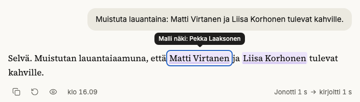

*On your screen: your message and the reply show the real names. A mark tells you what the model saw.*

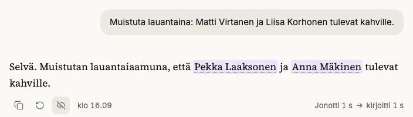

*The reply as the model wrote it: realistic surrogates in place of the names. A switch in the app
shows this view.*

A personal assistant for one person, on one small server. You talk to it in Finnish from a phone or
a desktop browser; it searches the web, works with your files, draws charts and diagrams, remembers
what you approve, and runs scheduled tasks. Before any model sees a message, the names, ID numbers,
addresses and emails in it become realistic surrogates. All model traffic leaves through one proxy,
to OpenRouter endpoints with zero data retention (ZDR). It is built on
[Pi](https://www.npmjs.com/package/@earendil-works/pi-coding-agent), the agent runtime
(`@earendil-works/pi-coding-agent` 1.4.0). It exists because nothing off the shelf combined frontier
models, Finnish pseudonymization and data that stays on a box you own.

## What makes it different

**Real values never reach a model.** [`packages/pi-ext-pseudo`](../packages/pi-ext-pseudo/src/index.ts)
masks each message at Pi's `input` hook, unmasks tool arguments only when the tool runs, masks every
tool result, and scans the whole context before each model call. If
[`pseudo-svc`](../services/pseudo-svc) is down, the turn stops; it never falls back to clear text.
Titles, topics, memory extraction and subagents read the same masked text.
[`tests/masked-only`](../tests/masked-only/src/masked-only.test.ts) runs a 10-turn tool conversation
and a restart, then searches every session file, every model request and the server log for each
real value.

`pseudo-svc` (FastAPI, Presidio, spaCy, Voikko, Omorfi) gives each person a surrogate that inflects
like a Finnish name, so `Virtaselle` can go out as `Laaksoselle` and the model writes natural
Finnish. It keeps the pairs in its vault, an SQLCipher database. The server restores the stream
with a short hold-back, so a surrogate split across two chunks never shows half-restored
([`restore.ts`](../apps/server/src/restore.ts)).

**One egress URL, zero data retention.** Pi knows two providers, and both point at LiteLLM. Only
LiteLLM holds the OpenRouter keys. [`zdr_guard.py`](../infra/litellm/zdr_guard.py) allows only listed
aliases and the `zdr/*` and `open/*` routes, each pinned to its provider block, and refuses unknown
request keys, `extra_body` and plugins. Every `zdr/` request carries `provider.zdr`, on a key that
sits under an OpenRouter ZDR guardrail. [`tests/egress`](../tests/egress/src/egress.test.ts) runs
LiteLLM and Presidio against a mock OpenRouter. A chat can leave ZDR after a refusal; it then uses a
separate key and stays pseudonymized ([phase 10](decisions/phase-10-models.md)).

**Harness tools: the assistant edits its own setup, with a diff.** The harness tools work on the
assistant itself, outside the current chat: `profile_edit` changes its prompt, `automation_edit`
writes a cron automation, and `chat_read` reads another chat. Each one shows a diff or a YAML card
first ([`harness.ts`](../apps/server/src/harness.ts)), and each saved change is a git commit on the
data volume. `profile_edit` cannot change tools, approvals or the model
([phase 25](decisions/phase-25-harness-tools.md)).

**Approval cards that code enforces.** `write`, `edit`, `bash` and the harness tools stop in a Pi
`tool_call` hook until you answer a card built from the call's real arguments
([`approval.ts`](../apps/server/src/approval.ts)). The harness tools always ask, even when auto-approve
is on for the chat. A scheduled run has no one to ask, so it denies every gated tool that its
automation does not list. A message whose tool calls repeat or lack an id is refused
([`search-tool.ts`](../apps/server/src/search-tool.ts)). A harness card in a turn that read outside
content says so.

**`fetch_url` with an SSRF guard.** It sends one GET with no body, cookie or key, to ports 80 and 443 only,
through a DNS-pinned lookup that refuses private addresses
([`net.ts`](../services/sandbox-broker/src/net.ts)). Each redirect is checked again, the body is capped
at 2 MB, and a URL that you did not write waits for a card
([`fetch-tool.ts`](../apps/server/src/fetch-tool.ts)).

**Sandboxed commands.** The agent's `bash` tool runs every command in a new, throwaway container.
Only `sandbox-broker` holds the Docker socket. Each container runs as uid 10001, with a read-only
root, `CapDrop: ALL`, `no-new-privileges`, pid, memory and CPU limits, a seccomp profile that denies
symlinks, and no network by default ([`index.ts`](../services/sandbox-broker/src/index.ts)). A skill can
ask for a list of hosts, which it reaches only through the broker's proxy, or for the open internet
([`skills/README.md`](../skills/README.md)). Skills come only from this repository; none is vendored
yet. [`tests/sandbox`](../tests/sandbox/src/sandbox.test.ts) drives the broker against real containers.

**Local-first data with consistent backups.** SQLite in WAL mode, Pi's JSONL sessions and Markdown
memory live under one `/data` volume. Search is hybrid and stays in SQLite: FTS5 trigram, sqlite-vec
and reciprocal rank fusion over local multilingual-e5 embeddings
([`search.ts`](../apps/server/src/search.ts)). Every hour the backup service takes consistent copies of
`app.db` and of the vault, and every night restic snapshots all of `/data`.
[`restore.sh`](../scripts/restore.sh) refuses a database that fails `PRAGMA integrity_check`, and
[`restore-drill.sh`](../scripts/restore-drill.sh) exercises the restore.

## Architecture

Eight long-running services on one Docker Compose stack, plus a one-shot init container that sets
the permissions of the Google token volume. The stack is built for one Coolify host, a 4 vCPU, 8 GB
VPS. Only `pa-server` is exposed. It runs Pi in-process through the SDK, one session per open chat,
and talks to the browser in a zod-typed WebSocket protocol
([`packages/protocol`](../packages/protocol/src/index.ts)). Raw Pi events never reach the browser.

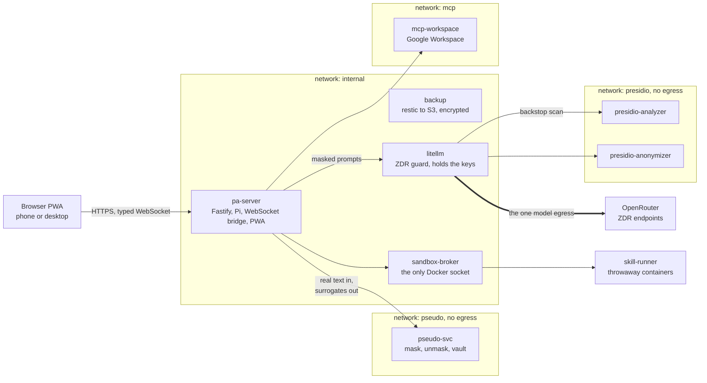

One turn, end to end:

1. The PWA sends `user.message` over the WebSocket.
2. `pi-ext-pseudo` masks it at Pi's `input` hook, and the vault records the surrogates.
3. Pi calls the model through LiteLLM with masked history and masked memory.
4. A tool call is unmasked only when it runs; its result is masked before Pi reads it.
5. The bridge restores the stream for display and sends typed frames to the browser.

Other outbound calls carry no model traffic: `fetch_url` GETs, the public model catalog, the ECB
exchange rate, Web Push, Google APIs from `mcp-workspace`, and the encrypted backups. The repository
layout is in [`AGENTS.md`](../AGENTS.md#layout).

## A tour

The interface follows a written design brief ([`phase-9-ui.md`](decisions/phase-9-ui.md),
section 7): a cream canvas, serif replies in one centered column, ink for the one primary action,
and controls that stay quiet until you need them. The UI is in Finnish. The names and data in these
shots are synthetic.

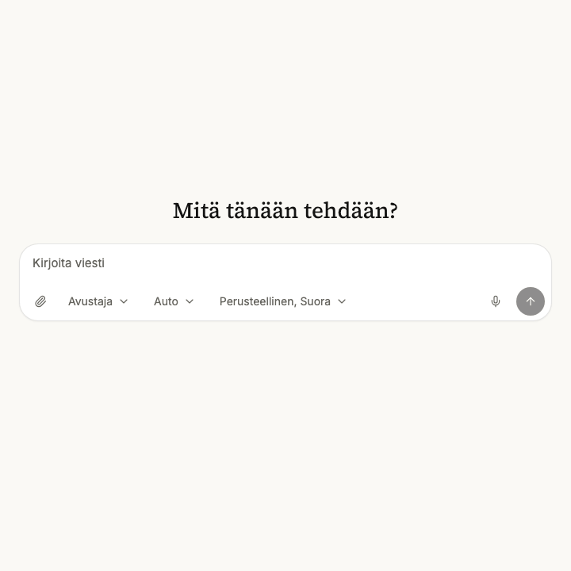

A reply streams in. The waiting line counts the queue, the thinking and the writing, and the caret
stays on the last character.

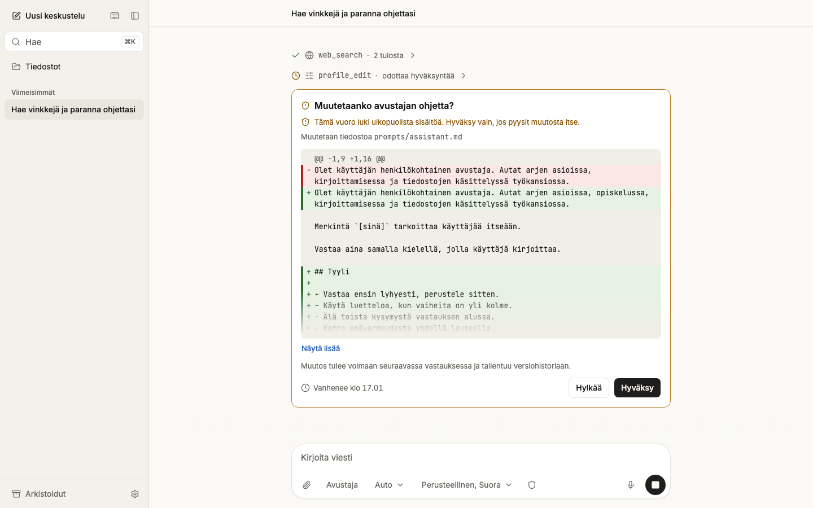

*`profile_edit` waits for a card with the diff. The turn read outside content, so the card warns.*

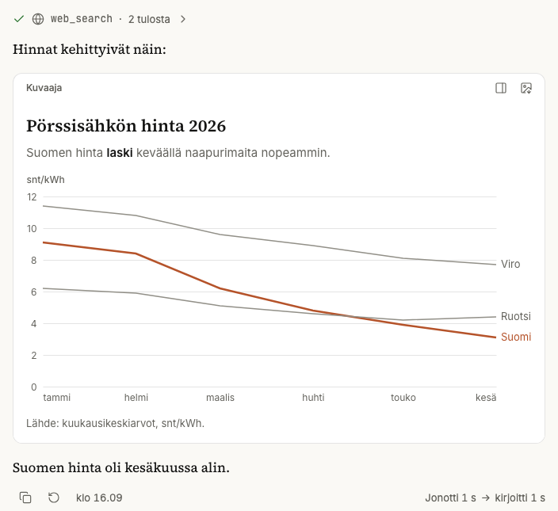

*A web search, then a Vega-Lite chart inline in the reply, drawn with the app's theme.*

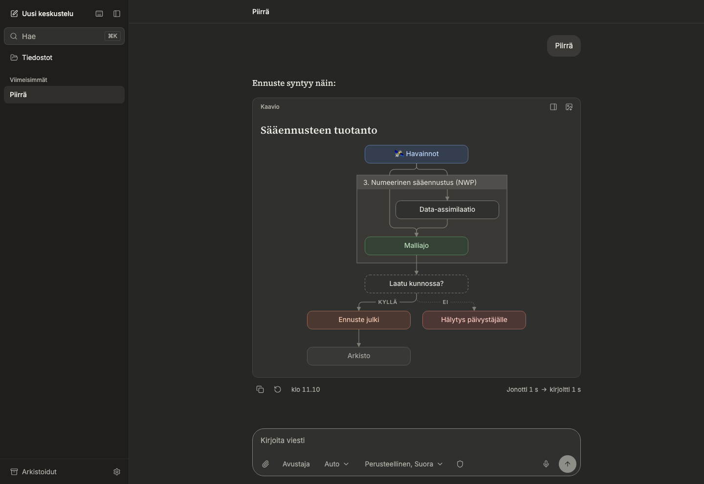

*Mermaid diagrams get the "Sarake" look. Dark mode has its own palette.*

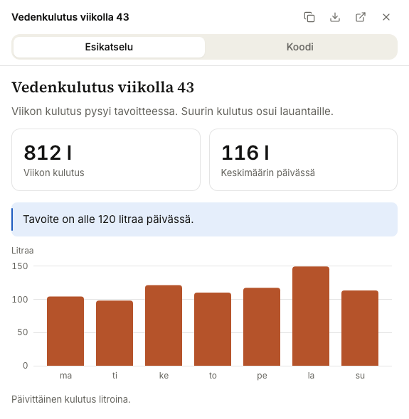

*HTML artifacts run in a sandboxed frame in the side panel, styled by a shared design kit.*

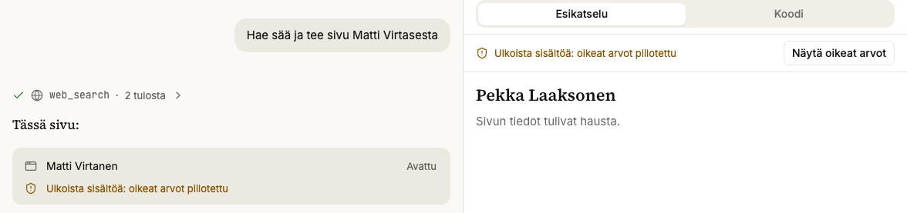

*A page from a chat that read outside content runs on surrogates. "Näytä oikeat arvot" asks before
it shows real values.*

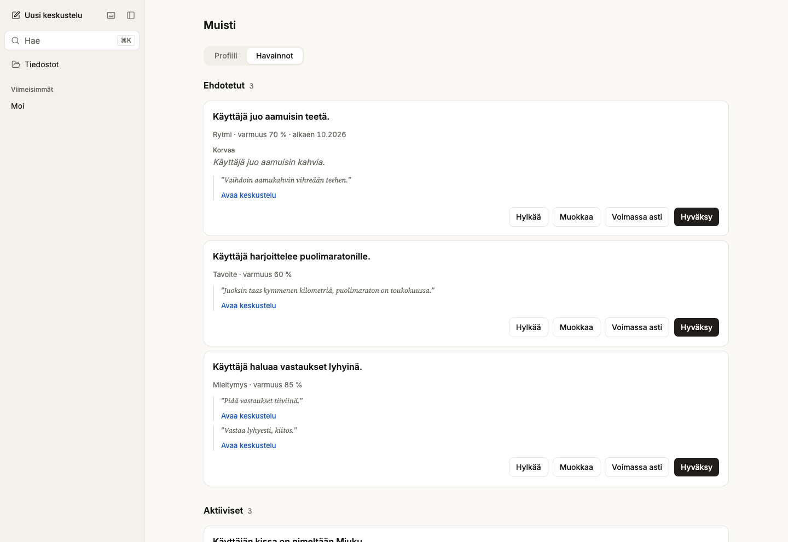

*Memory is a list of claims with evidence quotes. A proposed claim waits for your review.*

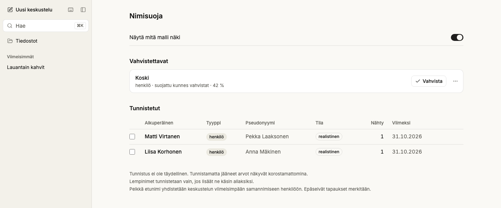

*The vault screen lists each real value and its surrogate. A weak detection stays masked until you
confirm it.*

<table>
<tr>
<td width="55%">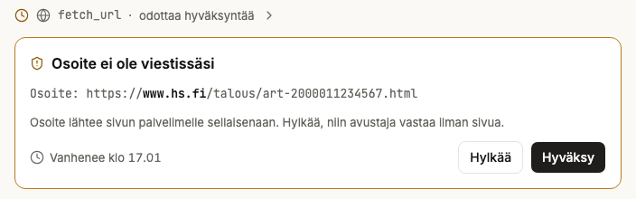</td>
<td width="45%">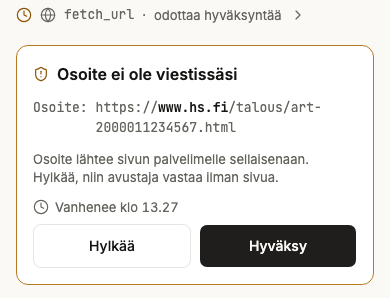</td>
</tr>
<tr>
<td colspan="2">A <code>fetch_url</code> call to an address that you did not write waits for a card. The same kind of card at 1440 px and on a 390 px phone.</td>
</tr>
</table>

## How it was built

One person and Claude Code, in more than 370 commits.

- **A plan before code.** [`docs/plan.md`](plan.md) fixed the invariants, the architecture,
  the protocol, the PII and memory designs, the UI spec, and the phases with their gates before the
  first commit.
- **Claude Code as the orchestrator.** It held the plan, cut each phase into task cards, gave the
  architecture-bearing tasks to Opus and the well-specified leaf tasks to Sonnet, and merged.
- **Review before every merge.** A separate reviewer checked each change against its acceptance
  test, the invariants and security. Review fixes land as their own commits before the merge, and
  the commits keep their `Co-Authored-By: Claude` trailers.
- **A blind, scored screenshot review** of every UI change, at three widths in light and dark.
- **29 phases done, numbered to 31** (phase 18 deferred, 29 reserved), with 39 decision records in
  [`docs/decisions/`](decisions/README.md): one per finished phase, plus ten for cross-cutting
  decisions such as the Pi contract and the Finnish PII stack. Each newer record lists the review
  findings that were left as they are, on purpose.
- **Three audits before publication**: [security](audits/2026-10-31-security.md) (2 blocking,
  6 should-fix, 14 nice-to-have), [architecture](audits/2026-10-31-architecture.md) (1 blocking,
  14 should-fix, 29 nice-to-have) and [supply chain](audits/2026-10-31-dependencies.md) (1,260
  npm lock entries and 64 Python packages against advisory, malware and IOC lists: no malicious
  package, nothing to remove). Phase 30 fixed the blocking and the security findings and most
  architecture findings; [its record](decisions/phase-30-audits.md) lists each fix and what
  stays.

No CI test needs a model key. Only the memory eval does: it asks a real model through LiteLLM and
runs locally. [`tests/fake-llm`](../tests/fake-llm/src/index.ts) is an in-process OpenAI-compatible server
with scripted turns, and fakes stand in for `pseudo-svc` and the sandbox broker.

| Suite | What it checks | Size or result |
|---|---|---|
| Vitest | the real server driven over its socket, the web app, the protocol, the database, the Pi extensions, MCP and the fake LLM | 572 tests: server 259, web 182, protocol 57, Pi extensions 49, mcp 14, fake-llm 7, db 4; one server test (OCR) skips without `tesseract` |
| [`tests/contract`](../tests/contract/src/hooks.test.ts) | the hook payloads and session behaviour of the pinned Pi version | 28 tests |
| [`tests/masked-only`](../tests/masked-only/src/masked-only.test.ts) | no real value in sessions, model requests or the server log | a 10-turn tool conversation and a restart |
| Playwright `chromium` ([flows](../tests/e2e/src/flows.spec.ts), [screens](../tests/e2e/src/screens.spec.ts)) | user flows, and every screen at 390, 1024 and 1440 px, light and dark, with strict axe checks | 86 flows and 582 screen tests: 658 pass, 10 skip by design |
| [`tests/pii`](../tests/pii/README.md) | recall and precision gates on 554 labelled Finnish texts ([last run](../tests/pii/last-run.json)) | ID numbers, IBANs, phones, emails, postcodes: 100 % recall. Names: 0.986 recall (0.978 for names the vault has not seen), 0.991 precision. Addresses: 0.953 recall. Plates: 0.714 recall, no gate |
| [`tests/memory-eval`](../tests/memory-eval/src/run.ts) | 100 questions over 30 synthetic Finnish chats, with a real `pseudo-svc` and model ([result](../tests/memory-eval/results/2026-10-27-real.json)) | gold evidence reaches the model: 0.988; answer accuracy 0.72 to 0.82 over six runs |
| [`tests/egress`](../tests/egress/src/egress.test.ts), [`tests/sandbox`](../tests/sandbox/src/sandbox.test.ts) | LiteLLM and Presidio against a mock OpenRouter; the broker with real containers (Docker) | 25 and 19 tests |

CI ([`ci.yml`](../.github/workflows/ci.yml)) runs typecheck, lint, the unit suites, the contract tests,
`tests/masked-only` and the Playwright run on every push to `main` and on every pull request. The
Docker suites, the PII harness, the memory eval and the restore drill run locally.

## Run it

Try the interface with no keys and no Docker. A fake model echoes the masked text that it got:

```sh
pnpm install && pnpm --filter @pa/web build
node tests/e2e/src/demo.ts        # http://localhost:3000, password: salasana
```

Develop against real services: copy `.env.example` to `.env`, fill in the values, then run the
commands below. `AUTH_PASSWORD_HASH` in `.env` has `$$` for compose; the shell needs a single `$`,
so set that one by hand ([Develop](development.md#develop)).

```sh
pnpm install
set -a; source .env; set +a; pnpm --filter @pa/server dev
pnpm --filter @pa/web dev
```

[`docs/deploy.md`](deploy.md) is the runbook for the VPS and for a full local run with Docker.
[`docs/development.md`](development.md) has the prerequisites, the test commands, the
dependency policy and the status of each phase. Contributors and coding agents start with
[`AGENTS.md`](../AGENTS.md).

## Status and limits

It runs for one user, in Finnish first. Every row has a `user_id`, so more users are a schema
no-op, but nothing else is built for them. Deferred: a direct search backend (web search goes
through OpenRouter's Exa plugin today), text-to-speech, and multi-user.

Known limits, from the records: detection is not perfect, and nicknames outside the table or rare
inflections can slip through; the vault screen says so. Images and voice audio reach the model
unmasked, through ZDR endpoints. A web search query reaches Exa unmasked when it names no vault
entity. The [threat model](threat-model.md) states what the system protects, against whom, and the risks that stay.

MIT license, see [`LICENSE`](../LICENSE).
